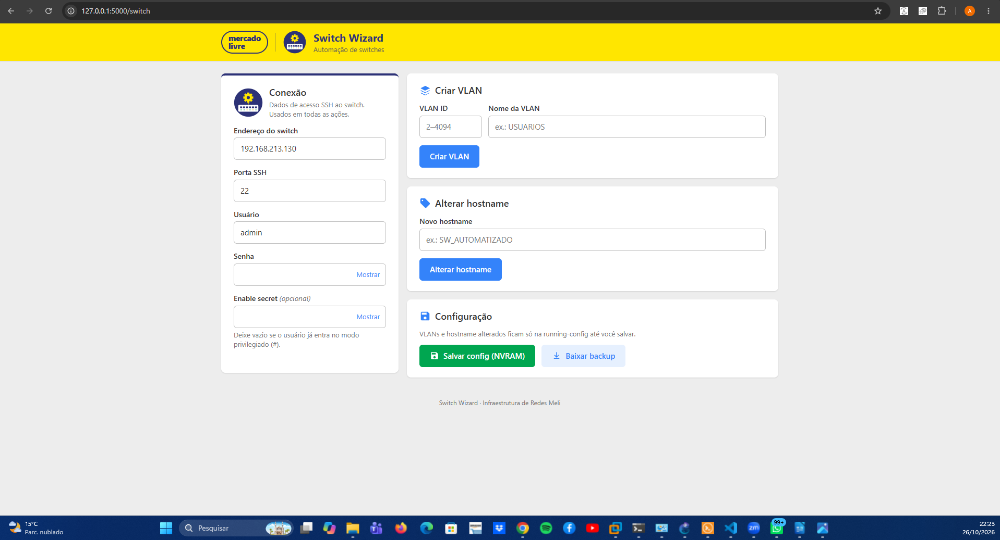

# Switch Wizard

[](https://sonarcloud.io/summary/new_code?id=antoniomsousa_automacao_switches)

Web frontend (Flask) to configure Cisco IOS switches over SSH (Netmiko):

- Create a VLAN (ID + name)
- Change the hostname
- Save the configuration to NVRAM (`write memory`)
- Download a backup of the running-config (includes the VLANs from `vlan.dat`)

The interface is in Brazilian Portuguese.



## Structure (MVC)

```
app/
  __init__.py                       create_app(): creates the Flask app and registers the blueprints
  models/
    switch.py                       Model: Switch class (SSH session and commands on the switch)
    validation.py                   Model: VLAN, hostname and port rules
  controllers/
    switch_controller.py            Controller: / and /switch routes
  templates/
    base.html                       View: layout (header with logos, footer)
    switch/form.html                View: form
    switch/result.html              View: result / error
  static/
    css/style.css                   Styling (Mercado Livre colors)
    js/app.js                       Browser-side validation, loading screen, copy buttons
    img/switch-automation.svg       Switch Wizard logo
tests/
  fake_switch.py                    Simulated Cisco IOS switch (FakeNOS)
  conftest.py                       pytest fixtures
  test_switch.py                    Tests of the actions against the simulated switch
  test_validation.py                Tests of the validation rules
  test_csrf.py                      Tests of the CSRF protection
run.py                              Entry point
```


## Installation

```
pip install -r requirements.txt          # to run
pip install -r requirements-dev.txt      # to run + test
```

## Usage

```
python run.py
```

Open http://127.0.0.1:5000 and enter the switch's IP, SSH port, username and password.

The form is protected against CSRF (Flask-WTF). The session key is random on every start; to keep it across restarts, set the `SECRET_KEY` environment variable.

## Testing without a real switch

Simulated switch on `127.0.0.1:6000` (user `admin` / password `admin`), to test from the browser:

```
python -m tests.fake_switch
```

Automated tests (they start their own simulated switch on a free port):

```
python -m pytest
```
