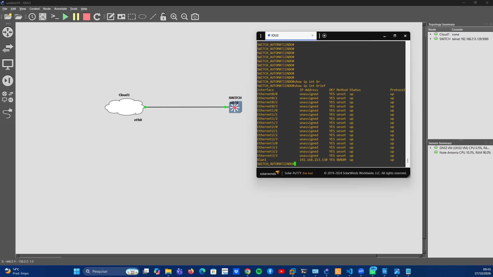

# Challenge - Networking

[](https://sonarcloud.io/summary/new_code?id=antoniomsousa_automacao_switches)

Web frontend (Flask) to configure Cisco IOS switches over SSH (Netmiko):

- Create several VLANs at once (ID + name per row), in a single configuration session
- Change the hostname
- Save the configuration to NVRAM (`write memory`)
- Download a backup of the running-config (includes the VLANs from `vlan.dat`)
- Validate the switch against the desired configuration and alert on any divergence

In the **Criar VLANs** card, **+ Adicionar VLAN** adds a row, **×** removes one, and **Preencher padrão (10, 20, 50)** fills in the challenge's VLANs. Empty rows are ignored, and repeated or invalid IDs are rejected, with the line number, before connecting to the switch (up to 50 VLANs per request).

After every change, the app reads the configuration back from the switch (`show vlan brief`, `show running-config | include ^hostname`) and compares it with what was requested. The **Validar configuração** button compares the whole switch with the standard configuration of the challenge: VLAN 10 `VLAN_DADOS`, VLAN 20 `VLAN_VOZ`, VLAN 50 `VLAN_SEGURANCA` and hostname `SWITCH_AUTOMATIZADO`. Any difference is shown as a **"Configuração não padrão encontrada"** alert, listing each item with the expected and found values.

VLAN names are converted to ASCII before they're sent: `VLAN_SEGURANÇA`, as written in the challenge, becomes `VLAN_SEGURANCA`. IOS VLAN names should be plain ASCII, since an accented character can be stored or echoed differently over SSH, which would break the validation.

The interface is in Brazilian Portuguese.


## Structure (MVC)

```
app/
  __init__.py                       create_app(): creates the Flask app and registers the blueprints
  models/
    switch.py                       Model: Switch class (SSH session and commands on the switch)
    compliance.py                   Model: standard configuration and desired vs. found comparison
    validation.py                   Model: VLAN, hostname and port rules
  controllers/
    switch_controller.py            Controller: / and /switch routes
  templates/
    base.html                       View: layout (header with logos, footer)
    switch/form.html                View: form
    switch/result.html              View: result / error
  static/
    css/style.css                   Styling (Mercado Livre colors)
    js/app.js                       Browser-side validation, loading screen, copy buttons
    img/switch-automation.svg       Switch Wizard logo
tests/
  fake_switch.py                    Simulated Cisco IOS switch (FakeNOS)
  conftest.py                       pytest fixtures
  test_switch.py                    Tests of the actions against the simulated switch
  test_validation.py                Tests of the validation rules
  test_csrf.py                      Tests of the CSRF protection
  test_vpn.py, fake_firewalls.py    Part 2: VPN automation tests against simulated firewall APIs
vpn_ipsec/                          Part 2: IPsec VPN automation plan and scripts (see below)
run.py                              Entry point
```


## Installation

```
pip install -r requirements.txt          # to run
pip install -r requirements-dev.txt      # to run + test
```

## Usage

```
python run.py
```

Open http://127.0.0.1:5000 and enter the switch's IP, SSH port, username and password.

The form is protected against CSRF (Flask-WTF). The session key is random on every start; to keep it across restarts, set the `SECRET_KEY` environment variable.

## Testing without a real switch

Simulated switch on `127.0.0.1:6000` (user `admin` / password `admin`), to test from the browser:

```
python -m tests.fake_switch
```

Automated tests (they start their own simulated switch on a free port):

```
python -m pytest
```

## Part 1: Switch Automation

Tested against a Cisco switch emulated in GNS3: IOU L2 image, IOS XE 17.15, reached over SSH at 192.168.213.130.



Everything is in [ENTREGAVEIS_PT1/](ENTREGAVEIS_PT1/):

| Deliverable | File |
|---|---|
| GNS3 lab running: Cloud1 connected to the IOU switch, Vlan1 at 192.168.213.130 | [GNS3_RUNNING.png](ENTREGAVEIS_PT1/GNS3_RUNNING.png) |
| VLANs 10, 20 and 50 created in one request, validated, and listed in the switch CLI (`show vlan`) | [CRIA_VLANS.png](ENTREGAVEIS_PT1/CRIA_VLANS.png) |
| Hostname changed to `SWITCH_AUTOMATIZADO`, validated, and the CLI prompt changing | [ALTERA_HOSTNAME.png](ENTREGAVEIS_PT1/ALTERA_HOSTNAME.png) |
| Validation with an alert: VLAN 20 removed from the switch, reported as "Configuração não padrão encontrada" | [VLAN_NOK.png](ENTREGAVEIS_PT1/VLAN_NOK.png) |
| Validation OK: the switch matches the standard configuration | [VALIDA_HOSTNAME.png](ENTREGAVEIS_PT1/VALIDA_HOSTNAME.png) |
| Input validation in the browser (invalid VLAN ID and name) | [ERR_VLAN.png](ENTREGAVEIS_PT1/ERR_VLAN.png) |
| Login failure alert | [ERR_LOGINSW.png](ENTREGAVEIS_PT1/ERR_LOGINSW.png) |
| Configuration saved to NVRAM (`write memory`) | [SALVA_CFG.png](ENTREGAVEIS_PT1/SALVA_CFG.png) |
| Backup download | [FUNC_BKP.png](ENTREGAVEIS_PT1/FUNC_BKP.png) |
| **Backup file** (hostname and date/time in the name) | [SWITCH_AUTOMATIZADO_20261027_000901.cfg](ENTREGAVEIS_PT1/SWITCH_AUTOMATIZADO_20261027_000901.cfg) |

In the backup file, the local username and its password hash were replaced by `<removed>` before publishing.

## Part 2: IPsec VPN automation plan (FortiGate ↔ Palo Alto)

The plan is in [vpn_ipsec/PLAN.md](vpn_ipsec/PLAN.md): parameters (WAN IPs, LANs, tunnel 169.255.1.0/30, phase 1/2 proposals), tools and APIs, automation steps, multi-vendor considerations, and the validation and alerting strategy.

The same folder implements the plan:

```
vpn_ipsec/
  PLAN.md                     The automation plan
  params.yaml                 VPN parameters (single source of truth)
  params.py                   Parameter validation and per-vendor proposal names
  fortigate.py                FortiOS REST API client and objects
  paloalto.py                 PAN-OS XML API client and objects
  deploy.py                   plan / apply / validate, with backup, rollback and alerts
  connectivity_test.py        Connectivity test through the tunnel
  alerts.py                   Alerts (log, chat webhook, exit code)
  configs/fortigate.conf      Example FortiOS CLI configuration
  configs/paloalto.set        Example PAN-OS configuration (set format)
```

```
python -m vpn_ipsec.deploy plan                       # validates params.yaml and lists every API call, no device access
python -m vpn_ipsec.deploy apply                      # needs FGT_TOKEN, PANOS_API_KEY and VPN_PSK
python -m vpn_ipsec.deploy validate                   # read-only: configuration drift + tunnel status
python -m vpn_ipsec.connectivity_test --site fortigate --remote-host 10.20.0.10
```

The tests in `tests/test_vpn.py` run the automation against in-memory FortiOS and PAN-OS APIs (`tests/fake_firewalls.py`).
