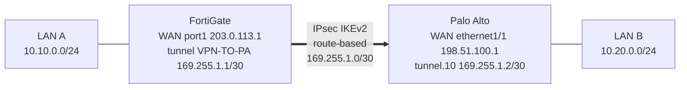
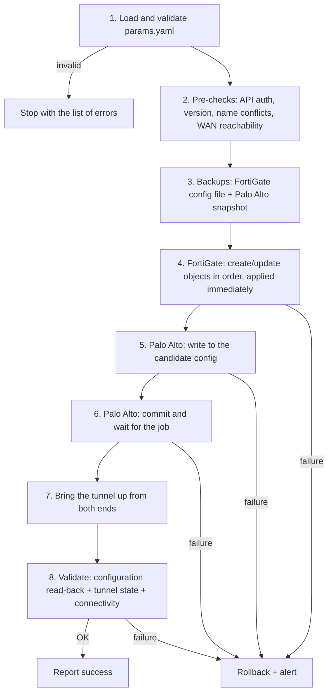

# IPsec VPN Automation Plan: FortiGate ↔ Palo Alto

This is the plan for automating a site-to-site IPsec VPN between a **FortiGate** (site A) and a **Palo Alto** firewall (site B). Along with the plan, this folder has a working implementation of it:

| File | What it is |
|---|---|
| [`params.yaml`](params.yaml) | Every VPN parameter, in one file (single source of truth) |
| [`params.py`](params.py) | Loads and validates the parameters, and translates proposals into each vendor's names |
| [`fortigate.py`](fortigate.py) | FortiGate objects and FortiOS REST API client |
| [`paloalto.py`](paloalto.py) | Palo Alto objects and PAN-OS XML API client |
| [`deploy.py`](deploy.py) | `plan` / `apply` / `validate` commands, with backup, rollback and alerts |
| [`connectivity_test.py`](connectivity_test.py) | Connectivity test through the tunnel |
| [`alerts.py`](alerts.py) | Alerts: log, chat webhook and exit code |
| [`configs/fortigate.conf`](configs/fortigate.conf) | Example FortiOS CLI configuration |
| [`configs/paloalto.set`](configs/paloalto.set) | Example PAN-OS configuration in `set` format |
| [`../tests/test_vpn.py`](../tests/test_vpn.py) | Tests against in-memory FortiOS and PAN-OS APIs ([`fake_firewalls.py`](../tests/fake_firewalls.py)) |

> The code was tested against simulated APIs, not real firewalls. The endpoints, XPaths and CLI commands follow FortiOS 7.x and PAN-OS 10.x/11.x. Before production use, validate them in a lab with the target versions (see [Limitations](#7-limitations-and-next-steps)).

---

## 1. Topology



The VPN is **route-based**: each side has a tunnel interface with an address in 169.255.1.0/30, and traffic to the remote LAN is sent to that interface by a static route. This model was chosen over policy-based because:
- both vendors support it natively (FortiGate `phase1-interface`, Palo Alto `tunnel.N`);
- the tunnel IPs allow monitoring (ping between the ends) and, later, dynamic routing (BGP over the tunnel) without redoing the VPN;
- adding networks only takes a new route and selector, without touching phases 1 and 2.

---

## 2. Parameter definition

All values live in [`params.yaml`](params.yaml). The WAN and management IPs are documentation ranges (RFC 5737), and the LANs are example private networks.

### 2.1 Addressing

| Parameter | FortiGate (site A) | Palo Alto (site B) |
|---|---|---|
| Management (API) | 192.0.2.10 | 192.0.2.20 |
| WAN interface | `port1` | `ethernet1/1` (zone `untrust`) |
| WAN IP (IKE peer) | **203.0.113.1**/24 | **198.51.100.1**/24 |
| LAN interface / zone | `port2` | zone `trust` |
| Local network (example) | **10.10.0.0/24** | **10.20.0.0/24** |
| Tunnel interface | `VPN-TO-PA` (created by the phase1-interface) | `tunnel.10` (zone `vpn`, virtual router `default`) |
| **Tunnel IP (169.255.1.0/30)** | **169.255.1.1** | **169.255.1.2** |

Tunnel network 169.255.1.0/30:

| Address | Use |
|---|---|
| 169.255.1.0 | network |
| 169.255.1.1 | FortiGate end |
| 169.255.1.2 | Palo Alto end |
| 169.255.1.3 | broadcast |

### 2.2 Phase 1 (IKE), compatible on both sides

| Parameter | Value | FortiOS | PAN-OS |
|---|---|---|---|
| IKE version | IKEv2 | `ike-version 2` | `protocol version ikev2` |
| Authentication | Pre-shared key (≥ 16 characters, from a vault or environment variable) | `authmethod psk` | `authentication pre-shared-key` |
| Encryption | AES-256-CBC | `proposal aes256-sha256` | `encryption aes-256-cbc` |
| Integrity / PRF | SHA-256 | (part of the proposal) | `hash sha256` |
| Diffie-Hellman | Group 14 (2048-bit MODP) | `dhgrp 14` | `dh-group group14` |
| Lifetime | 28800 s (8 h) | `keylife 28800` | `lifetime seconds 28800` |
| DPD | Enabled | `dpd on-idle` | `ikev2 dpd enable yes` |
| NAT-T | Enabled | `nattraversal enable` | `nat-traversal enable yes` |

### 2.3 Phase 2 (IPsec ESP)

| Parameter | Value | FortiOS | PAN-OS |
|---|---|---|---|
| Protocol | ESP | (default) | `esp` |
| Encryption | AES-256-CBC | `proposal aes256-sha256` | `esp encryption aes-256-cbc` |
| Integrity | SHA-256 | (part of the proposal) | `esp authentication sha256` |
| PFS | Group 14 | `pfs enable` + `dhgrp 14` | `dh-group group14` |
| Lifetime | 3600 s (1 h) | `keylifeseconds 3600` | `lifetime seconds 3600` |
| Selectors (traffic selectors / proxy-ID) | Local 10.10.0.0/24 ↔ remote 10.20.0.0/24 | `src-name` / `dst-name` on phase2 | `proxy-id local 10.20.0.0/24 remote 10.10.0.0/24` |

AES-GCM (`aes256gcm`) is also supported in phase 2. With GCM, the FortiGate proposal has no hash (`aes256gcm`), and on the Palo Alto ESP authentication must be `none`. `params.py` makes that translation automatically.

### 2.4 Validation rules for the parameters

Before touching any device, [`params.py`](params.py) refuses parameters that would produce a broken VPN. It reports every problem at once:
- `tunnel_network` must be a /30, and the two tunnel IPs must be exactly its two usable addresses;
- the WAN IPs must differ, and the LANs can't overlap each other or the tunnel network;
- algorithms must come from the list both vendors support (AES-128/256, SHA-256/384/512, DH 14/19/20/21), and only IKEv2 is accepted;
- lifetimes must fall within the range both vendors accept, with phase 2 shorter than phase 1;
- interface names must be valid for each vendor (FortiGate ≤ 15 characters, Palo Alto `tunnel.N`);
- the PSK must be at least 16 characters and is read from the environment, never from the file.

---

## 3. Tools and APIs

### 3.1 Options per vendor

| Category | FortiGate | Palo Alto |
|---|---|---|
| **Native REST API** | **FortiOS REST API**: `/api/v2/cmdb/...` (configuration) and `/api/v2/monitor/...` (state), authenticated with an API token (*REST API Admin*) | **PAN-OS XML API**: `/api/?type=config\|op\|commit` with an API key (`type=keygen`). PAN-OS 9.0+ also has a REST API (`/restapi/v10.2/...`) for objects and policies, but it doesn't cover all of the network configuration |
| **Python SDK** | `fortiosapi`, `pyfortiapi` (wrappers around the REST API) | `pan-os-python` (official, object model), `pan-python` (XML API) |
| **SSH / CLI** | Netmiko (`fortinet`), Paramiko | Netmiko (`paloalto_panos`) |
| **Declarative / IaC** | Ansible `fortinet.fortios`, Terraform provider `fortios` | Ansible `paloaltonetworks.panos`, Terraform provider `panos` |
| **Central management** | **FortiManager** (JSON-RPC API, ADOMs, policy packages, *VPN Manager*) | **Panorama** (templates/template stacks for network config, device groups for policies, same XML API) |
| **Orchestration** | Nornir, Ansible, CI/CD pipelines (GitHub Actions, GitLab CI), AWX/Ansible Tower ||
| **Secrets** | HashiCorp Vault, Azure Key Vault, AWS Secrets Manager, or CI environment variables (PSK, token, API key) ||
| **Monitoring** | SNMP traps (`vpn-tun-up/down`), syslog, FortiAnalyzer | SNMP traps, syslog / log forwarding, Panorama, Strata Logging Service |

### 3.2 Choice for this plan

- **FortiOS REST API and PAN-OS XML API, called from Python with `requests`.** These are the native interfaces with the widest coverage, they return structured data that can be validated, and they need no extra dependencies. The XML API is used on the Palo Alto because, unlike its REST API, it covers the whole network configuration (IKE, IPsec, tunnel interfaces, virtual router).
- **SSH (Netmiko) only as a fallback**, for example for diagnostic commands when the API is unavailable. CLI output is text and changes between versions, so it's more fragile to validate than JSON or XML.
- **In an environment with many firewalls,** the same logic would move to **FortiManager and Panorama**, with templates per site, or to **Ansible/Terraform** using the official collections and providers. Central management avoids drift between the manager and the device, which happens when a device is configured directly.

---

## 4. Automation steps

### 4.1 Flow



`deploy.py` implements this flow:

```bash
export FGT_TOKEN=... PANOS_API_KEY=... VPN_PSK=... ALERT_WEBHOOK_URL=...   # optional webhook
python -m vpn_ipsec.deploy plan       # no device access: validates the parameters and lists every API call (PSK masked)
python -m vpn_ipsec.deploy apply      # steps 1-8, with rollback
python -m vpn_ipsec.deploy validate   # step 8 only, read-only (for monitoring)
```

### 4.2 Step by step

**1. Parameters.** Load `params.yaml`, validate it (section 2.4), read the PSK from the environment or a vault, and translate the proposals into each vendor's syntax.

**2. Pre-checks.**
- Authenticate to both APIs (token / API key) and read the version (`GET /api/v2/monitor/system/status`; `<show><system><info/></system></show>`), to choose the right endpoints.
- Check for name conflicts: an existing object with the same name but a different purpose.
- Check that each WAN reaches the peer on UDP 500/4500. This needs a ping from the firewall itself, or a check of upstream ACLs.
- In the current `deploy.py`, these pre-checks are reduced to authenticating: the first API call fails with a clear error if the token or key is wrong. The version and name-conflict checks are part of the plan but not implemented yet.

**3. Backups.**
- FortiGate: `GET /api/v2/monitor/system/config/backup?scope=global`, saved to a file.
- Palo Alto: `<save><config><to>pre-vpn-<timestamp>.xml</to></config></save>`, a named snapshot of the running configuration.

**4. FortiGate.** Changes take effect as soon as each call is made, so the order matters, since each object depends on the previous ones:

| # | Object | Endpoint (FortiOS REST API) |
|---|---|---|
| 1 | Address objects for the local and remote LANs | `POST /api/v2/cmdb/firewall/address` |
| 2 | Phase 1 (gateway + proposal + PSK) | `POST /api/v2/cmdb/vpn.ipsec/phase1-interface` |
| 3 | Phase 2 (proposal + PFS + selectors) | `POST /api/v2/cmdb/vpn.ipsec/phase2-interface` |
| 4 | Tunnel interface IP (169.255.1.1, remote-ip 169.255.1.2/30, ping allowed) | `PUT /api/v2/cmdb/system/interface/VPN-TO-PA` |
| 5 | Static route to 10.20.0.0/24 through the tunnel, plus a blackhole route (distance 254) | `POST /api/v2/cmdb/router/static` |
| 6 | Firewall policies LAN→VPN and VPN→LAN, without NAT | `POST /api/v2/cmdb/firewall/policy` |

**5–6. Palo Alto.** Changes go to the candidate configuration and only take effect when committed:

| # | Object | XPath (under `/config/devices/entry[@name='localhost.localdomain']`) |
|---|---|---|
| 1 | IKE crypto profile | `network/ike/crypto-profiles/ike-crypto-profiles` |
| 2 | IPsec crypto profile | `network/ike/crypto-profiles/ipsec-crypto-profiles` |
| 3 | Interface management profile (ping) | `network/profiles/interface-management-profile` |
| 4 | Tunnel interface `tunnel.10` 169.255.1.2/30 | `network/interface/tunnel/units` |
| 5 | Tunnel in the virtual router, the vsys and zone `vpn` | `network/virtual-router/.../interface`, `vsys/.../import/network/interface`, `vsys/.../zone` |
| 6 | IKE gateway (IKEv2, PSK, peer 203.0.113.1) | `network/ike/gateway` |
| 7 | IPsec tunnel (gateway + profile + proxy-ID + tunnel monitor) | `network/tunnel/ipsec` |
| 8 | Static route to 10.10.0.0/24 through `tunnel.10` | `network/virtual-router/.../routing-table/ip/static-route` |
| 9 | Address objects and security rules trust↔vpn | `vsys/.../address`, `vsys/.../rulebase/security/rules` |

Then a single `type=commit`, polling `<show><jobs><id>N</id></jobs></show>` until `FIN`. If the result isn't `OK`, the job's error message goes into the alert.

**7. Bring the tunnel up.** IKE only negotiates when there's traffic, so the script triggers negotiation explicitly, without waiting for user traffic:
- FortiGate: `POST /api/v2/monitor/vpn/ipsec/tunnel_up`, equivalent to `diagnose vpn tunnel up`.
- Palo Alto: `<test><vpn><ike-sa><gateway>...` and `<test><vpn><ipsec-sa><tunnel>...`.

**8. Validate.** See section 6.

### 4.3 Idempotency and rollback

- **Idempotent.** Before writing anything, the script reads the current object and compares it with the desired state. On the FortiGate it does `GET`, then `POST` if the object is missing, `PUT` if it differs, and nothing if it's equal. On the Palo Alto, `action=edit` replaces the whole entry, and `action=set` merges members into lists. Running `apply` twice gives the same result, and the second run writes nothing.
- **Rollback.**
  - FortiGate: delete the objects created by this run, in reverse order, so that an object that already existed is never removed.
  - Palo Alto: before the commit, `revert config` discards the candidate. After the commit, the script loads the snapshot from step 3 and commits again.
  - In both cases an alert reports the stage where it failed.

---

## 5. Specific considerations (multi-vendor)

1. **Different terminology and object models.** The same VPN is a `phase1-interface` plus a `phase2-interface` on the FortiGate, but on the Palo Alto it's an *IKE crypto profile*, an *IPsec crypto profile*, an *IKE gateway*, an *IPsec tunnel* and a *tunnel interface*. The automation needs a **vendor-neutral model** (`params.yaml`) and a translation layer per vendor.
2. **Different names for the same algorithm.** `aes256` vs `aes-256-cbc`, `14` vs `group14`, a combined proposal `aes256-sha256` vs separate fields. With GCM, the FortiGate has no hash while the Palo Alto needs `authentication none`. Translation tables, plus checking only algorithms both vendors support, avoid "no proposal chosen".
3. **Traffic selectors / proxy-IDs.** This is the most common cause of a tunnel where phase 1 comes up and phase 2 doesn't. By default the FortiGate proposes 0.0.0.0/0 ↔ 0.0.0.0/0, and the Palo Alto (without a proxy-ID) does the same. If one side uses specific networks, the other must too, **mirrored** (local and remote swapped). The script builds both from the same parameters.
4. **Commit model.** On the FortiGate each call takes effect at once. On the Palo Alto nothing takes effect until the commit, which runs as an asynchronous job that can take minutes. Rollback strategy and timeouts differ per side, and there's a window where one side is configured and the other isn't.
5. **Partial failure between two devices.** No transaction spans both firewalls. If the Palo Alto commit fails after the FortiGate was configured, the FortiGate has to be undone too. The script tracks what it created on each side so it can undo it.
6. **Zones and routing on the Palo Alto.** A tunnel interface with no zone, no virtual router or no vsys import makes the commit fail, or the traffic gets dropped. On PAN-OS 10.2+ with the Advanced Routing Engine, the virtual router becomes a *logical router* with a different XPath. The script would need to detect which one is in use.
7. **Firewall policies and NAT.**
   - Both vendors need explicit policies in both directions.
   - On the FortiGate the policy has `nat disable`. Otherwise traffic to the remote LAN gets source-NATed to the WAN IP.
   - On the Palo Alto, traffic to zone `vpn` doesn't match the source NAT rule to zone `untrust`, but that has to be checked in each environment.
8. **Tunnel IPs.**
   - On the FortiGate, the interface takes `ip 169.255.1.1/32` and `remote-ip 169.255.1.2/30`.
   - On the Palo Alto, `tunnel.10` takes `169.255.1.2/30`.
   - Both need ping allowed on the tunnel interface for monitoring.
   - **169.255.1.0/30 is not link-local** (that's 169.254.0.0/16, RFC 3927). It's technically public address space, but it works here because it never leaves the tunnel. Using it must not collide with any real route.
9. **Identification and NAT.** If either peer is behind NAT, NAT-T (UDP 4500) is required, and `local-id`/`peer-id` may need setting. Otherwise the IKE gateway is identified by IP and won't match.
10. **Lifetimes and rekey.** Different lifetimes still negotiate, since the shorter one wins in IKEv2, but they can make rekeys asymmetric and cause short drops. The plan uses the same values on both sides.
11. **Secrets.** The PSK, FortiOS token and PAN-OS API key never go into the repository. They come from a vault or environment variables, they're masked in `plan` and in logs, and the PSK is never compared on read-back, because both vendors return it encrypted.
12. **Versions and APIs.** Endpoints and fields change between FortiOS and PAN-OS versions. The pre-check reads the version, and the code isolates each vendor in its own module, so adapting to a new version only touches that module.
13. **TLS certificates.** Management interfaces often use self-signed certificates. The script verifies TLS by default, and `--insecure` exists only for labs.
14. **High availability.** With HA pairs, the API calls go to the active unit (or the cluster IP). On the Palo Alto, HA config sync takes care of the passive unit after the commit.

---

## 6. Configuration validation and alerts

### 6.1 Validation layers

| Layer | What it checks | How |
|---|---|---|
| **1. Parameters** (before deploying) | Consistency: /30, IPs, overlaps, compatible algorithms | `params.validate()`; `deploy plan` |
| **2. Configuration** (read-back / drift) | Each desired object exists on the device with the expected values | FortiGate: `GET` on each object and field-by-field comparison (normalizing `a.b.c.d/nn` ↔ `a.b.c.d m.m.m.m`). Palo Alto: `type=config&action=show` on each XPath, checking that every desired leaf is in the running configuration. The PSK is skipped. |
| **3. Control plane** (IKE/IPsec state) | Phase 1 and phase 2 are up on **both** sides | FortiGate: `GET /api/v2/monitor/vpn/ipsec` (`proxyid[].status == "up"`, byte counters). Palo Alto: `<show><vpn><flow><name>FGT-PA</name></flow></vpn></show>` (`state == active`). |
| **4. Data plane** (connectivity) | Traffic actually passes, layer by layer | [`connectivity_test.py`](connectivity_test.py): ping the local tunnel IP, then the remote tunnel IP, then remote LAN hosts, then TCP ports |
| **5. Continuous monitoring** | The tunnel stays up and the configuration doesn't drift after deployment | `deploy validate` scheduled (cron/CI every N minutes), Palo Alto tunnel monitor (ping to 169.255.1.1), SNMP traps / syslog from both firewalls |

### 6.2 Equivalent manual commands

| Check | FortiGate CLI | Palo Alto CLI |
|---|---|---|
| Tunnel summary | `get vpn ipsec tunnel summary` | `show vpn flow name FGT-PA` |
| Phase 1 | `diagnose vpn ike gateway list name VPN-TO-PA` | `show vpn ike-sa gateway FGT-PA-GW` |
| Phase 2 / SAs | `diagnose vpn tunnel list name VPN-TO-PA` | `show vpn ipsec-sa tunnel FGT-PA` |
| Ping through the tunnel | `execute ping-options source 169.255.1.1` + `execute ping 169.255.1.2` | `ping source 169.255.1.2 host 169.255.1.1` |
| Route | `get router info routing-table details 10.20.0.0/24` | `show routing route destination 10.10.0.0/24` |
| IKE debug | `diagnose debug application ike -1` + `diagnose debug enable` | `debug ike global on debug` + `less mp-log ikemgr.log` |

### 6.3 Divergence diagnosis

The validation reports **which side** failed, which narrows down the cause:

| Symptom | Likely cause |
|---|---|
| Drift: object missing or a field differs | Manual change on the device, or a partial deploy. Re-run `apply`, which is idempotent. |
| Phase 1 down on both sides | WAN can't reach the peer (UDP 500/4500), wrong peer IP, PSK or phase 1 proposal mismatch |
| Phase 1 up, phase 2 down | Phase 2 proposal or PFS mismatch, or **proxy-IDs / selectors not mirrored** |
| Only one side reports the tunnel down | SAs out of sync (e.g. one side rebooted), or that side's tunnel monitor failing |
| Tunnel up, remote tunnel IP doesn't answer ping | Ping not allowed on the tunnel interface, or a missing route or zone on the Palo Alto |
| Tunnel IPs answer, remote LAN doesn't | Missing route to the LAN, firewall policy, NAT applied to VPN traffic, or a host firewall |

### 6.4 Alerts

[`alerts.py`](alerts.py) is used by `deploy.py` and `connectivity_test.py`:
- **Log:** always written, at ERROR level, with the list of problems.
- **Webhook:** if `ALERT_WEBHOOK_URL` is set, the alert is posted as `{"text": ...}`, a format Slack, Microsoft Teams and Google Chat accept. A broken webhook doesn't hide the original failure: the script still logs it and exits with an error.
- **Exit code:** the scripts exit with **1** on validation or connectivity failure and **2** on invalid parameters. So a scheduler (cron, a CI job, Rundeck/AWX) or a monitoring tool can treat the run as a failed check and alert on its own.

Every alert says what failed, on which side, and at which stage. For example:

```
VPN FGT-PA: validation failed
- Palo Alto: tunnel FGT-PA is down
- only one side reports the tunnel down: check proposals, proxy-IDs and routing on that side
```

In production, `deploy validate` and `connectivity_test` would run on a schedule. Their alerts would reach the same tool that receives SNMP traps (Zabbix, PRTG, Prometheus + Alertmanager) or the on-call channel. The firewalls' own events add to this: FortiGate `vpn-tun-down` traps, and Palo Alto system logs for tunnel status changes.

---

## 7. Limitations and next steps

- **Tested against simulated APIs.** The tests in [`tests/test_vpn.py`](../tests/test_vpn.py) cover the flows (apply, idempotency, drift, rollback, alerts) against in-memory implementations of both APIs. They don't replace a lab run with real FortiOS and PAN-OS, which can be virtual (FortiGate-VM, VM-Series) in EVE-NG or GNS3.
- **Advanced Routing Engine (PAN-OS 10.2+).** The XPath of the virtual router changes to a logical router. The pre-check would have to detect this.
- **Central management.** With FortiManager and Panorama, the configuration should go through them (templates, policy packages and device groups) rather than straight to the devices. Otherwise the managers report drift.
- **Certificate authentication** (PKI) instead of a PSK, for environments with many VPNs.
- **BGP over the tunnel** (169.255.1.1 ↔ 169.255.1.2) instead of static routes, for redundancy with a second tunnel.
